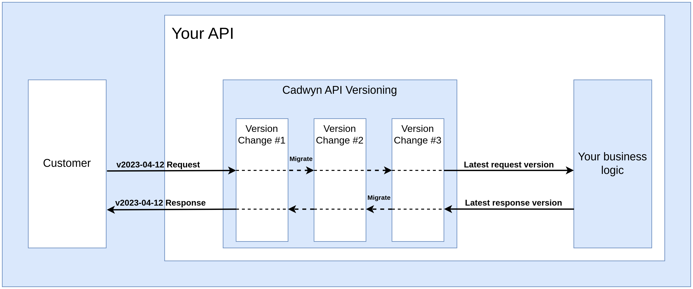

# Version Changes

Version changes are the backbone of Cadwyn. They allow to describe things like "this field in that schema had a different name in an older version" or "this endpoint did not exist in all earlier versions".

In Cadwyn, your business logic always works with a single version: HEAD, which represents your latest version. This approach decouples your business logic from versioning and allows you to support hundreds of API versions using the same database models and business logic, while staying sane.

Follow these steps to add a new version:

1. Introduce a breaking change in your HEAD version
2. Apply reverse changes to older versions using special "migration instructions" so that your current users are not affected by the breaking changes

Migration instructions for reverting breaking changes should be grouped to simplify maintenance efforts. For example, renaming the `creation_date` field to `created_at` and deleting the `GET /v1/tax_ids` endpoint are unrelated changes and should be placed in separate groups. In contrast, deleting the `POST /v1/tax_ids` endpoint should be grouped with deleting the `GET /v1/tax_ids`. Such grouping makes the changes easier to understand for both your users and developers.

Each such group is called a **version change**:

```python
{! ./docs_src/concepts/version_changes/block001.py !}
```

After describing the groups, add your version change class(es) to your version bundle to activate them:

```python
{! ./docs_src/concepts/version_changes/block002.py !}
```

This instructs Cadwyn to **un**delete these endpoints in all versions before 2023-02-10.

The following explains what each part does and why:

## VersionBundle

`VersionBundle` is the single source of truth for your list of versions. It stores all versions and all [version changes](#version-changes) associated with them. Each version change represents a group of breaking changes. Each `Version` contains a group of version changes that led to its creation. For example, if you delete the `POST /v1/tax_ids` endpoint in version `2023-02-10`, you need to add a corresponding version change to the `2023-02-10` version. For example:

```python
{! ./docs_src/concepts/version_changes/block002.py !}
```

Did you notice that the initial `2022-11-16` version has no version changes? That is intentional. How could it have breaking changes if there were no prior versions?

## Version

`Version` is an ordered collection of version changes that describes when each version change occurred allowing Cadwyn to generate schemas and routes for all versions correctly, based on which version changes belong to which versions.

### HeadVersion

Cadwyn has a special HEAD version: it is the only version you will create manually and use directly in your business logic. Cadwyn generates all other versions from HEAD version. When handling an HTTP request, Cadwyn first validates it against the requested API version. Then all the converters from the requested API version up to the latest API version are applied to it. Finally, Cadwyn converts the request to the requested schema from HEAD version (the schema that was used to generate the versioned schema from the requested API version).

So Cadwyn migrates all requests from all versions to HEAD version to ensure that your business logic operates on a single version.

HEAD is very similar to your latest version but for a few key differences:

* Latest is user-facing while HEAD is only used internally by you and Cadwyn
* Latest is generated while HEAD is maintained by you manually
* Latest includes only the fields that API user is supposed to see while HEAD may include some fields missing from latest. For example, if an earlier version contained a field completely incompatible with latest, HEAD will still include it to ensure that older versions continue to function as before. This also applies to field types: if a field is required in latest but was nullable in an earlier version, then HEAD will keep it nullable to ensure that earlier version requests can easily be converted into HEAD requests
* Latest may include constraints that are incompatible with older versions while HEAD may contain none. If you prefer, the user-facing schemas are applied for validation before the request is converted to HEAD so HEAD does not need to re-validate anything if you do not want it to

## VersionChange

`VersionChange` classes describe each atomic group of business capabilities that you have altered in a version.

Note, however, that a migration is required only if it is a breaking change for your users. If you add a new endpoint or a new field to your response schema, you do not need a migration because it will not break your users’ code. If you do not create a migration, this change is automatically added to all versions.

### VersionChange.\_\_name\_\_

The name of a version change should clearly describe the breaking change it introduces. For example, `RemoveTaxIdEndpoints` immediately communicates what has changed. The name should begin with a verb and serve as the primary clue for developers unfamiliar with the history of the project to understand the difference between versions. Do not hesitate to use long, descriptive names. It is better to choose a verbose name that precisely conveys the change than a short, generic one. For example `RenameCreationDatetimeAndUpdateDatetimeToCreatedAtAndUpdatedAt` is far more informative than `RefactorFields`. After only a few poorly named version changes, the entire versioning history can become difficult to read and understand:

```python
{! ./docs_src/concepts/version_changes/block003.py [ln:46-] !}
```

### VersionChange.description

Write the description of your version change as its class docstring. Cadwyn uses this docstring as the `description` of the version change.

The description should clearly communicate to your clients **what happened** and **why**. Make it grammatically correct, detailed, specific, and written for humans. Note that you do not have to use a strict machine-readable format: it is a piece of documentation, not a set of instructions. As a reference, consider the following [version change description from Stripe](https://stripe.com/blog/api-versioning):

```md
Event objects (and webhooks) will now render a `request` subobject that contains a request Id and idempotency key instead of a string request Id.
```

It is concise, descriptive, and human-readable — qualities of effective technical documentation. Now compare it with a less helpful description:

```md
Migration from the first version (2022-11-16) to 2023-09-01 version.
Changes:
* Changed schema for `POST /v1/tax_ids` endpoint
```

* Its first line, `Migration from the first version (2022-11-16) to 2023-09-01 version.`, duplicates the already-known information. Your developers can determine which version `VersionChange` migrates to and from by its location in [VersionBundle](#versionbundle) and most likely by its file name. So it is redundant information
* Its second line, `Changes:`, does not provide useful information either because a description of a `VersionChange` cannot describe anything but changes. So again, it is redundant information
* Its third line, `Changed schema for 'POST /v1/tax_ids' endpoint`, provides both too much and too little information. It states that a schema was changed but it does not specify what was changed. The goal is to make it easy for your clients to migrate from one version to the next. A more useful description would mention the OpenAPI model name that was changed, the fields that were modified, and the reason for those changes

### VersionChange.instructions_to_migrate_to_previous_version

In Cadwyn, you use the latest version. This attribute allows you to describe how your schemas and endpoints looked in previous versions. Cadwyn uses this information to determine how to generate the schemas and routes to recreate the previous schemas and endpoints for your clients. So you only need to maintain your head (latest) schemas and your migrations while Cadwyn handles the rest. In fact, you put minimal effort into **maintaining** your migrations because they are effectively immutable records of the breaking changes that happened in the past. Once written, they do not need to be modified.

This approach of *maintaining the present and describing the past* may seem counterintuitive at first. The key is to adopt the correct mindset. After one or two attempts at versioning you will see how much sense this approach makes.

Suppose you need to know what your code looked like two weeks ago. You would use `git checkout` or `git reset` to jump to an older commit because Git stores the latest version of your code (referred to as HEAD) and the diffs between it and each previous version as a chain of changes. Cadwyn works the same way: Cadwyn stores only the latest version and regenerates previous versions on demand using diffs.

<details>
  <summary>Note for curious readers</summary>

  Git doesn't actually work this way internally. The description above is closer to how SVN works. It is just a simple metaphor to explain a concept.
</details>

### Data migrations

Consider a scenario where you rename the `creation_date` field to `created_at`. You have updated your schemas — that's great! However, clients using previous versions of the API will continue to send requests containing `creation_date` instead of `created_at`. How do you handle this? Well, in Cadwyn your business logic never receives requests from the previous versions. Instead, it receives only the requests of the latest version. So whenever you define a version change that renames a field, you also need to specify how to convert the request body from the previous version to the new one. For example:

```python
{! ./docs_src/concepts/version_changes/block004.py !}
```

Did you notice how the schema for `InvoiceCreateRequest` is specified in the migration above? This instructs Cadwyn to apply it to all routes that use this schema as their request body.

At this point, you have described not only how the schemas have changed, but also how to migrate a request from the previous version to the new one. When Cadwyn receives a request targeting a specific API version, it first validates the request against the schema for that version. Then Cadwyn applies each request migration in sequence up to the latest version. As a result, your business logic always receives the latest version of the request, while from your clients’ perspective, multiple API versions are available. Cadwyn allows you to support versioned APIs without adding complexity to your business logic.

A request migration can also remove a body that is not a form: if it sets `request.body = None`, the latest version gets the request without a body, so the defaults of its body params apply. If no migration assigns `request.body`, an omitted body stays omitted, and on FastAPI 0.151.0 and newer, a JSON `null` body stays `null`.

But wait... What happens to the `Invoice` responses? Your business logic now returns `created_at`, which means clients using previous API versions will be affected. Cadwyn solves this as well by allowing you to define response migrations. Requests are migrated forward in versions while responses are migrated backward in versions. In other words, your business logic returns a response of the latest version and Cadwyn will use your response migrations to migrate the response back to the version of your client's request:

```python
{! ./docs_src/concepts/version_changes/block005.py !}
```

Did you notice how the schema for `InvoiceResource` is specified in the migration above? This instructs Cadwyn to apply it to all routes with this schema as their `response_model`. Also notice that `BaseInvoice` is now used in the instructions. Here, `BaseInvoice` is the parent of both `InvoiceCreateRequest` and `InvoiceResource`, so renaming it in the instructions will rename the field in those schemas as well. You can, however, apply the instructions to both individual schemas instead of their parent if you prefer.

!!! note "Migrations only run for the schema you name"
    Instructions such as `schema(InvoiceResource).field(...).had(...)` change the schema everywhere it is used, including inside other schemas and generics. Request and response migrations are different: a schema-based migration only runs when its schema is the request body or the `response_model` of the route itself. It does not run for that schema nested in another one, e.g. in a field of another schema or inside a generic such as `Page[InvoiceResource]`, so write the migration for the outer schema instead. This is a deliberate choice: each migration runs exactly where you declared it and never twice for the same data.

When a request comes in, Cadwyn migrates it to the latest version using the request migration. You then handle your business logic, return the latest response, and Cadwyn migrates it back to the requested API version. Does your business logic or database know that you have two versions? No, not at all. It is zero-cost. Consider the benefits of supporting not just two, but two hundred versions.



Did you **notice** how the **latest** versions of the schemas are used in the migration above? Such pattern can be found everywhere in Cadwyn. The latest version of your schemas is used to describe what happened to all other versions because other versions might not exist when you are defining migrations for them.

#### Path-based migration specification

Often you need to migrate based on the endpoint path rather than the request body or response model. This happens when, for example, an endpoint does not have a request body, or its response model is used in other places that you do not want to migrate. Consider the example [above](#data-migrations), but use paths instead of schemas:

```python
{! ./docs_src/concepts/version_changes/block006.py !}
```

That said, schemas are highly recommended, since it is much easier to introduce inconsistencies when using paths. For example, if you have ten endpoints sharing the same response body schema, you might forget to add migrations for three of them because you are using paths instead of schemas.

#### Migration of HTTP errors

Often you need to raise `fastapi.HTTPException` in your code to signal an error to your users. However, changing the status code of an error would be a breaking change because your error status codes - and sometimes even the response bodies - are part of your API contract.

By default, Cadwyn's response migrations do not handle errors, but you can enable error handling with the `migrate_http_errors` keyword argument:

```python
{! ./docs_src/concepts/version_changes/block007.py !}
```

#### Migration of non-body attributes

Cadwyn can migrate more than just request bodies.

`RequestInfo` has the following interfaces to migrate requests:

* `body: Any`
* `headers: starlette.datastructures.MutableHeaders`
* `cookies: dict[str, str]`
* `query_params: dict[str, str]`
* `form: list[tuple[str, UploadFile | str]] | None` for requests to endpoints that declare their form fields as separate `Form()` or `File()` parameters. Otherwise it is `None`. For example, an endpoint that takes a single model through `Form()` gets the model's fields as a dict in `body` instead

If a migration reads an uploaded file from `form`, it must `seek` the file back to where the latest version should start reading it, usually `upload.file.seek(0)`. Otherwise, the latest version gets the file as the migration left it, e.g. empty.

`ResponseInfo` has the following interfaces to migrate responses:

* `body: Any`
* `status_code: int`
* `headers: starlette.datastructures.MutableHeaders`
* [set_cookie](https://starlette.dev/responses/#set-cookie)
* [delete_cookie](https://starlette.dev/responses/#delete-cookie)

#### Internal representations

So far, only simple cases have been considered. But what happens if you cannot migrate your data that easily? This can happen if your earlier versions stored **more data** than your newer versions. Or if they supported more data formats.

Suppose the `User` schema previously had a list of addresses, but now you want to make a breaking change and replace `addresses` with a single `address`. A naive migration would take the first address from the list in each request and convert that address into a list in each response as follows:

```python
{! ./docs_src/concepts/version_changes/block008.py !}
```

But this will not work. If the user of the previous version requests to save three addresses, only one will actually be saved. Existing data is also going to be affected: if old users had multiple addresses, only one of them will be returned. This is important: a breaking change has been introduced.

In order to solve this issue, Cadwyn uses a concept of **internal representations**. An internal representation of your data is like a database entry for your data — it consists of its **latest** version plus all the fields that are incompatible with the latest API version. If the discussion were about classes, then internal representation would be a child of your latest schemas - it has all the same data and a little more, expanding its functionality. Your internal representation of user object can contain much more data than your latest schemas.

So all your requests get migrated to HEAD, which is the internal representation of latest, rather than the latest itself. Its data is very similar to that of latest. The same applies to your responses: instead of responding with and migrating from the latest version of your data, you use its **internal representation** which is pretty similar to the actual latest schemas.

For responses, returning the internal representation is simple: return your database model or a dictionary with everything you need for all your versions. In the user address example, it is recommended to continue storing the list of addresses in the database and include a single address in a response. The latest schemas will strip it while previous schemas will be able to use it.

```python
{! ./docs_src/concepts/version_changes/block009.py [ln:18-] !}
```

So now your migration will look like the following:

```python
{! ./docs_src/concepts/version_changes/block010.py !}
```

Yes, you no longer need any of the migrations because responses are handled automatically. See the how-to section for an example of how to achieve the same result with requests.

#### Manual body migrations

Often you will need to migrate your data outside of routing, manually. For example, you might need to send a versioned response to your client via a webhook or inside a worker/cronjob. In these cases, use `cadwyn.schema_generation.migrate_response_body()`:


```python
{! ./docs_src/concepts/version_changes/block011.py !}
```

The returned `body_from_2000_01_01` is your data passed through all converters (as it would be when returned from your route) and wrapped in the `2000-01-01` version of `UserResource`. Because the data is wrapped, you can include Pydantic’s defaults.

#### StreamingResponse and FileResponse migrations

Migrations for the bodies of `fastapi.responses.StreamingResponse` and `fastapi.responses.FileResponse` are not directly supported yet ([1](https://github.com/zmievsa/cadwyn/issues/125), [2](https://github.com/zmievsa/cadwyn/issues/126)). However, you can use `ResponseInfo._response` attribute to get access to the original `StreamingResponse` or `FileResponse` and modify it as needed within your migrations.

## Pydantic RootModel migration warning

Pydantic has an implementation detail: `pydantic.RootModel` instances are memoized. So the following code is going to output `True`:

```python
{! ./docs_src/concepts/version_changes/block012.py !}
```

A migration intended for one of these schemas will affect both. A recommended alternative is to either use subclassing:

```python
{! ./docs_src/concepts/version_changes/block013.py !}
```

or to specify migrations using [endpoint path](#path-based-migration-specification) instead of a schema.

## Dependency re-execution warning

Notice that whenever a request reaches Cadwyn, it is first validated against the request's version of the schema, then it is migrated to the latest version, and then validated again to prevent migrations from creating invalid requests.

This means that if you have a dependency that is executed during the request validation, **it will be executed twice**. For example, if you have a dependency that checks whether a user exists in the database, it will be executed twice. This is not an issue if the dependency is idempotent, but it becomes one if it is not.

To solve this issue, you can use the `cadwyn.current_dependency_solver` dependency which tells you whether your dependency is called before or after the request is migrated. If you want to run it after Cadwyn has migrated the request to the latest version, ensure that `current_dependency_solver` is set to `"cadwyn"`. If you want your dependency to run at the very beginning of handling the request, you should run it when `current_dependency_solver` is `"fastapi"`.

```python
{! ./docs_src/concepts/version_changes/block014.py !}
```

but the majority of your dependencies will not need this as most dependencies should not have side effects or network calls within them.

Dependencies that read uploaded files or move their position (e.g. to skip a header) need care: both runs see the same files. Do such work in the run that gives your endpoint its arguments, i.e. when `current_dependency_solver` is `"cadwyn"`, or `"fastapi"` for requests that Cadwyn doesn't migrate (requests without an API version). Before the `"cadwyn"` run, Cadwyn moves the files that FastAPI has read for `bytes` params back to their start, so a file that a dependency has moved only in the `"fastapi"` run can be moved back.

### Versioned dependencies

In the first run, Cadwyn can give a dependency its version's copy, whose parameters (request bodies, query parameters, and so on) are validated and documented in OpenAPI with the request's version of their models and enums. Whether it does depends on how you declare the dependency:

* `value: T = Depends(f)`: every version, including the latest one, uses its copy of `f`.
* `value: Annotated[T, Depends(f)]` (or `Security(f)`, or `Annotated[f, Depends()]`): a version uses its copy of `f` if the models or enums that the parameters of `f` validate have instructions in a newer version or in `HeadVersion`. This includes the models and enums in sub-dependencies, in the types of the fields of models, and in the typed extra fields of models that allow them (`__pydantic_extra__`). It also includes the models whose bases have such instructions, unless these instructions only change fields that the model overrides without renaming them. It doesn't include what pydantic doesn't validate: class variables, default factories, fields that a subclass overrides, the type args of generic models that no field uses, and the args of generic type aliases that their values don't use (e.g. `Unused[Role]` with `type Unused[T] = str`), also behind other type aliases and in the parameters of `f`. In a type alias that refers to itself, such as `type Tree[T] = str | list[Tree[T]]`, the references to itself with the same args add nothing, so `Tree[Role]` doesn't count `Role`, while references with other args count their args. An alias that Cadwyn cannot expand (e.g. with a `TypeVarTuple`) counts all of its args. So the latest version uses its copy only if `HeadVersion` has such instructions. Other versions usually use `f` itself, with the latest models and enums, except where they already used copies before: when `T` refers to Pydantic models (Cadwyn copies them for every version) or to enums with instructions, when the other `Annotated` metadata cannot be hashed (e.g. `Security(f, scopes=[...])`), when Python's `typing` cache no longer holds the original `Annotated[...]` (it keeps a limited number of them, so in apps with many `Annotated` dependencies this can apply to every version; such copies use the same unversioned classes, so they behave the same), and for `Annotated[f, Depends()]`, which can already give `f` copies of the models and enums that its parameters use.
* Pydantic models used as dependencies, such as `Depends(Filters)`, are copied for every version in both forms, as before. Other classes, such as `Depends(RoleChecker)`, are not versioned: the parameters of their `__init__` use the latest models and enums in every version.

Where a version uses its copy of a dependency, the dependency receives that version's copies of the models and enums in the first run, not the classes themselves. So `isinstance(item, Item)`, `role is Role.admin`, `==` between the members of a plain `Enum`, and dicts keyed by enum members do not match them. Compare by value instead (e.g. `role.value == "admin"`), or do such work only when `current_dependency_solver` is `"cadwyn"`, where the dependency gets the latest classes. On FastAPI versions before 0.148, a default that is a member of a plain `Enum`, such as `role: Role = Query(Role.reader)` for a query, header, cookie, or form parameter, can also make requests that omit the parameter fail with a 422 when the version's enum rejects the latest member. A `str` or `int` enum (e.g. `class Role(str, Enum)`) avoids this unless the version removes the member or changes its value.

## Version changes with side effects

Sometimes you will use API versioning to handle a breaking change in your **business logic**, not in the schemas themselves. In such cases, it is tempting to add a version check and follow the new business logic such as:

```python
# This is wrong. Please do not do this.
if api_version_var.get() >= date(2022, 11, 11):
    # do new logic here
    ...
```

Instead, Cadwyn provides a special `VersionChangeWithSideEffects` class for handling such cases. It makes finding dangerous versions that have side effects much easier and provides a nice abstraction for checking whether you are on a version where these side effects have been applied.

As an example, let's use the tutorial section's case with the user and their address. Suppose you use an external service to check whether user's address is listed in it and return 400 response if it is not. Also suppose that you have only added this check in the newest version.

```python
{! ./docs_src/concepts/version_changes/block015.py !}
```

Then you will have the following check in your business logic:

```python
{! ./docs_src/concepts/version_changes/block016.py [ln:2-2,12-] !}
```

So this change can be contained in any version. Your business logic doesn't know which version it has. And shouldn't.

### Warning against side effects

Side effects are a very powerful tool but they must be used with great caution. Are you sure you MUST change your business logic? Are you sure what you are trying to do cannot just be done by a migration? 90% of time, you will **not** need them. Please think twice before using them. API versioning is about having the same underlying app and data while changing the schemas and API endpoints to interact with it. By introducing side effects, you leak versioning into your business logic and possibly even your data which makes your code significantly harder to maintain in the long term. If each side effect adds a single `if` statement to your logic, then after 100 versions with side effects, you will have 100 additional if statements. If used correctly, Cadwyn helps you maintain decades’ worth of API versions with minimal maintenance effort, and side effects make it significantly harder to do. Changes in the underlying source, structure, or logic of your data should not affect your API or public-facing business logic.

However, the [following use cases](../how_to/change_business_logic/index.md) often necessitate side effects.
