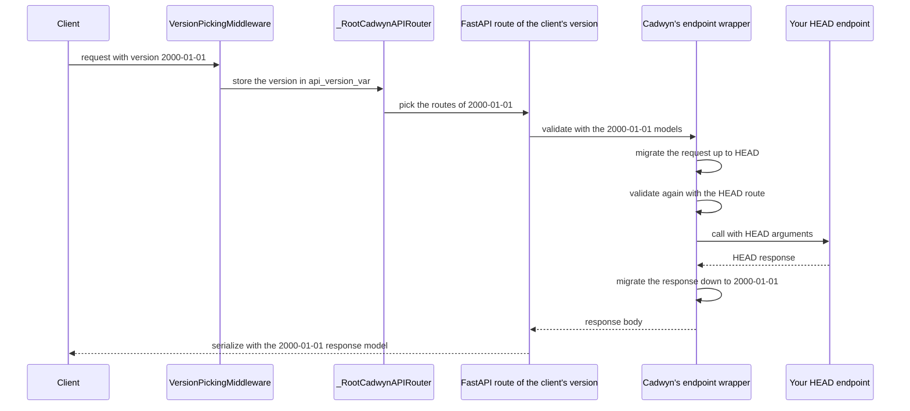

# Architecture

This page describes how Cadwyn works inside, at the level you need to change it. It doesn't repeat how to use Cadwyn: the [concepts](../concepts/index.md) pages cover that. For why Cadwyn works this way and what it has already decided, read [Design decisions and trade-offs](design_decisions.md).

## The big picture

You write one version of the app: the latest one, called HEAD. Each older version is described only by how it differs from the next newer one, in version changes. From these, Cadwyn builds two things:

1. **Before the first request**, it generates a copy of the models and the routes for every version.
2. **On every request**, it validates the request with the routes of the client's version, migrates it up to HEAD, calls your HEAD endpoint, and migrates the response back down to the client's version.

So your business logic only ever sees HEAD, and every version's OpenAPI comes from real FastAPI routes.

## Where the code lives

| Module | What it does |
| --- | --- |
| `cadwyn/structure/versions.py` | `VersionChange`, `Version`, `HeadVersion`, and `VersionBundle`. It also runs request and response migrations during a request (`VersionBundle._versioned()` and the methods it calls). |
| `cadwyn/structure/schemas.py`, `enums.py`, `endpoints.py` | The `schema()`, `enum()`, and `endpoint()` instructions. They only hold data: the generators apply them. |
| `cadwyn/structure/data.py` | `RequestInfo`, `ResponseInfo`, and the `convert_request_to_next_version_for()` and `convert_response_to_previous_version_for()` migrations. |
| `cadwyn/schema_generation.py` | Copies of models and enums for every version: `generate_versioned_models()` and `SchemaGenerator`. Also `migrate_response_body()`. |
| `cadwyn/route_generation.py` | Copies of routes for every version: `generate_versioned_routers()` and `VersionedAPIRouter`. |
| `cadwyn/applications.py` | `Cadwyn`, the FastAPI app. It wires everything together and serves the OpenAPI and docs pages of every version. |
| `cadwyn/middleware.py` | `VersionPickingMiddleware` and the version managers that read the version from a header or the path. |
| `cadwyn/routing.py` | `_RootCadwynAPIRouter`, which sends a request to the routes of its version. |
| `cadwyn/dependencies.py`, `cadwyn/_internal/context_vars.py` | `current_dependency_solver()` and the context variables behind it. |
| `cadwyn/__main__.py`, `_render.py`, `_asts.py` | The `cadwyn render` CLI, which prints a version's copies of models as code. |
| `cadwyn/changelogs.py` | The deprecated `/changelog` endpoint. |

## Versions and version changes

A `VersionBundle` lists the versions from newest to oldest, optionally after a `HeadVersion`. `VersionBundle.versions` keeps that order, and `VersionBundle.reversed_versions` goes from oldest to newest. The oldest version can't have version changes, and each version change belongs to exactly one version.

The changes of a version describe how to turn that version into the previous, older one. When a `VersionChange` subclass is created, `VersionChange.__init_subclass__()` checks it and sorts its instructions by kind:

* `instructions_to_migrate_to_previous_version` goes into `alter_schema_instructions`, `alter_enum_instructions`, and `alter_endpoint_instructions`.
* The request and response migrations in the class body go into `alter_request_by_schema_instructions`, `alter_request_by_path_instructions`, `alter_response_by_schema_instructions`, and `alter_response_by_path_instructions`.

Schema generation and route generation read only these sorted attributes. See [Version changes](../concepts/version_changes.md) for how users write them.

## Schema generation

`generate_versioned_models()` in `schema_generation.py` returns a `SchemaGenerator` for every version:

1. It wraps every model and enum that the version changes mention into an editable description of the class: a `_PydanticModelWrapper` (fields, annotations, validators, and bases) or an `_EnumWrapper` (members).
2. It applies the `HeadVersion` instructions to these wrappers. Then it goes through the versions from newest to oldest. For each version, it saves a copy of the current wrappers in that version's `SchemaGenerator`, and then applies that version's schema and enum instructions so that the next, older version sees them.
3. `SchemaGenerator[Model]` returns the version's copy of `Model` and creates it on first use. The copy is a new class built from the wrapper with the model's own metaclass. All the models it refers to (in fields, bases, generic args, and so on) are replaced by their copies for the same version. The copy keeps a link to its HEAD model in `__cadwyn_original_model__`.

Cadwyn copies every model for every version, even models without instructions, because the copies differ from HEAD in small ways that older versions rely on, such as their OpenAPI names. The exceptions are enums and models in reference cycles whose copies would be the same as HEAD: enum members must stay the same objects, and a cycle can only be copied as a whole (`_CycleCopier`). `SchemaGenerator._needs_copy()` makes this decision. See [Schema migrations](../concepts/schema_migrations.md), [Enum migrations](../concepts/enum_migrations.md), and [Schema generation](../concepts/schema_generation.md) for the user's side.

## Route generation

`Cadwyn.generate_and_include_versioned_routers()` only collects your routers. Cadwyn generates the routes before the first request, when the app gets its first ASGI call (`Cadwyn._cadwyn_initialize()`). It calls `generate_versioned_routers()` in `route_generation.py`, which works like schema generation, with a router instead of models:

1. It copies your router once as the HEAD router. Cadwyn never serves the HEAD router directly. It keeps it to call your endpoints with HEAD data.
2. It goes through the versions from newest to oldest with another copy of the router. For each version, it:
    1. replaces the models in the response models, dependencies, and endpoint signatures of every route with the version's copies from its `SchemaGenerator`, and rebuilds FastAPI's dependants for them;
    2. links the path-based request and response migrations of the version's changes to the matching HEAD routes;
    3. saves the router as the router of this version;
    4. copies it and applies the version's endpoint instructions to get the routes of the previous version. `endpoint(...).didnt_exist` tags a route as deleted instead of removing it, `endpoint(...).existed` removes the tag (routes marked with `@router.only_exists_in_older_versions` start tagged), and `endpoint(...).had(...)` changes the route's attributes.
3. Because routes are only tagged and never removed during this loop, every route keeps its index in every copy. Cadwyn uses that index to find the HEAD route of each versioned route. It wraps the endpoint of every versioned route, including the routes of the newest version, with `VersionBundle._versioned()`, which holds both routes.
4. Finally, it drops the routes tagged as deleted.

`Cadwyn` then adds each version's router to `_RootCadwynAPIRouter.versioned_routers`, with a dependency that documents the version header or path parameter in OpenAPI. `Cadwyn.openapi_jsons()` builds each version's OpenAPI from that version's routes. See [Endpoint migrations](../concepts/endpoint_migrations.md) for the user's side.

## The path of a request

1. `VersionPickingMiddleware` reads the version with a `HeaderVersionManager` or a `URLVersionManager`, falls back to `api_version_default_value`, and stores the version in `VersionBundle.api_version_var`. It also returns the version that was used in the response header.
2. `_RootCadwynAPIRouter` picks the routes: the unversioned routes if there's no version, the version's routes if it exists, or else, for date versions, the routes of the closest older version ([waterfalling](../concepts/api_version_parameter.md#api-version-waterfalling)).
3. The matched route is an ordinary FastAPI route of that version. FastAPI validates the request with the version's models and solves its dependencies, and then calls the route's endpoint, which is Cadwyn's wrapper.
4. The wrapper turns the validated body back into data (or reads the raw body or form) and puts it in a `RequestInfo`. `VersionBundle._migrate_request()` runs the request migrations of every version newer than the client's, from oldest to newest.
5. It then solves the dependencies of the HEAD route with FastAPI's `solve_dependencies()`. This validates the migrated request with the HEAD models and runs the dependencies a second time ([dependency re-execution](../concepts/version_changes.md#dependency-re-execution-warning)). If this validation fails, a migration is wrong, so Cadwyn raises `CadwynHeadRequestValidationError` instead of returning a 422.
6. It calls your endpoint with the HEAD arguments.
7. It puts the result, or the `HTTPException` that the endpoint raised, in a `ResponseInfo`. `VersionBundle._migrate_response()` runs the response migrations of every version newer than the client's, from newest to oldest. It migrates error responses only if the migration sets `migrate_http_errors=True`.
8. If the endpoint returned a body rather than a `Response`, FastAPI serializes the migrated body with the response model of the client's version.

Migrations by schema run only when the schema is the route's body or response model itself. Migrations by path run for the HEAD routes that route generation linked to them. See [Data migrations](../concepts/version_changes.md#data-migrations) for how users write migrations, and [Costs of the architecture](design_decisions.md#costs-of-the-architecture) for what this design costs.
